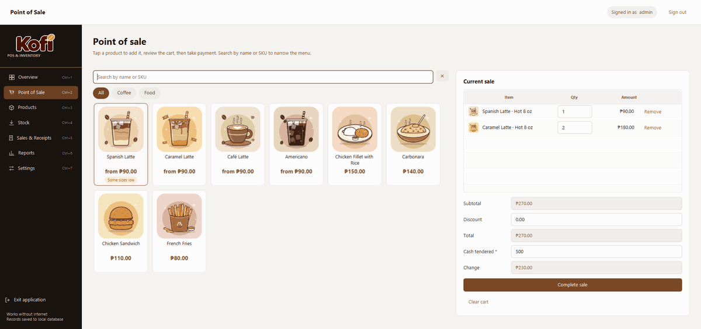

<div align="center">
  
  <h1>Kofi POS &amp; Inventory</h1>
  
  <p><strong> An Offline Point-of-Sale and Inventory Management System for Local Cafe Owners in Kalibo. </strong></p>
  <p> Note: Kofi template — each coffee shop gets its own customized version.  </p>
</div>

## Take a look



## What is Kofi?

Kofi is a desktop point-of-sale and inventory app for a single local shop. Cashiers can build a cart, take cash, and create receipts; owners can manage the menu, track stock movements, and review sales from the same application.

Designed to be lightweight and affordable for local cafe owners.

At runtime, the app works without internet. It keeps live records in Java collections and saves them in a local SQLite database, so there is no database server or network service to set up.


## What you can do

- **Ring up a sale:** Find products by name or SKU, edit quantities, apply a discount, enter cash tendered, and see the change due.
- **Manage the menu:** Add, edit, search, sort, deactivate, or remove products.
- **Track stock:** Record stock coming in, stock going out, and adjustments; review movement history and low-stock alerts.
- **Review transactions:** Search and sort sales, open receipt details, or void a sale with a reason and restore its stock.
- **Check the business:** See today's sales and recent activity on the dashboard, then view date-filtered sales and inventory cost reports.
- **Set up the shop:** Customize the store name, address, receipt footer, and sample data from Settings.

## Get started

### Requirements

- JDK 17 or newer
- Maven (or use `run.cmd` on Windows if Maven is available through PATH or the local Maven cache)

### Launch

On Windows, run:

```powershell
.\run.cmd
```

With Maven on your PATH, launch on any platform with:

```shell
mvn javafx:run
```

To open the project in an IDE, import it as a Maven project and run `com.kofi.pos.Launcher`.

### Demo sign-in

- **Username:** `admin`
- **Password:** `admin123`

## Keyboard shortcuts

| Keys | Action |
|---|---|
| Ctrl+1 to Ctrl+7 | Switch between Overview, Point of Sale, Products, Stock, Sales & Receipts, Reports and Settings |
| Ctrl+F or `/` | Move to the search box on the current screen |
| Ctrl+Enter | Complete the sale on Point of Sale (when the payment is valid) |
| Enter | Run the screen's main action, for example Complete sale from the cash field |
| Esc | Clear the search box or the current form; on Point of Sale, Esc pressed outside the search box clears the cart |

Shortcuts also appear in the sidebar and in button tooltips.

## Your local data

- On first launch, Kofi creates `data/kofi-pos.db` and loads its starter records from `src/main/resources/seed/seed.sql`.
- If legacy CSV records are present in `data/`, Kofi imports the records into their matching database tables in one transaction, then removes the migrated files.
- Changes are saved locally and remain after the app closes.
- Back up `data/kofi-pos.db` to keep a copy of the shop's records.
- Choose **Settings → Reset data to default** to restore the starter data.
- The sample menu includes 20 products: four coffee drinks in four sizes each, plus four food items. Starter prices, costs, and stock counts are placeholders; replace them with your shop's values.

## Built for CC 104

Required structures and algorithms support real app workflows:

- **Collections:** `ArrayList` for products and records, `LinkedList` for the editable POS cart, `Stack` for recent activity, and `Queue` for FIFO low-stock alerts.
- **Searching:** Linear search for product and receipt filters; binary search for exact SKU lookup in a sorted snapshot.
- **Sorting:** Handwritten insertion sort and selection sort for product, sale, and stock views.
- **Recursion:** Inventory valuation at cost.

## Under the hood

- **Platform:** JavaFX desktop app
- **Language:** Java 17
- **Build:** Maven
- **Persistence:** Local SQLite database; runtime records are held in Java collections
- **Package root:** `com.kofi.pos`

The app is organized into JavaFX views, store rules, domain models, and SQLite persistence. For the implementation details, see:

- [Architecture and design decisions](docs/architecture.md)
- [Code walkthrough](docs/code-walkthrough.md)
- [Requirements traceability](requirements.md)
