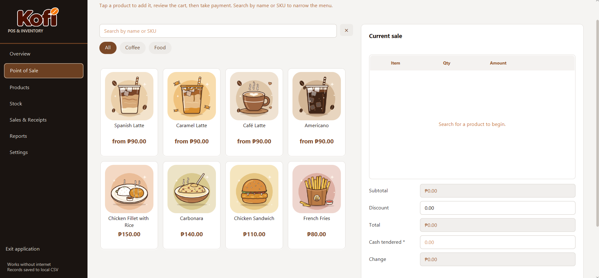

<div align="center">
  
  <h1>Kofi POS &amp; Inventory</h1>
  <p><strong>Point of sale and inventory for a local coffee shop, ready to run offline.</strong></p>
  <p>Built with Java 17 and JavaFX for a small coffee shop — and for a CC 104 project that puts data structures and algorithms to work.</p>
</div>

## Take a look



## What is Kofi?

Kofi is a desktop point-of-sale and inventory app for a single local shop. Cashiers can build a cart, take cash, and create receipts; owners can manage the menu, track stock movements, and review sales from the same application.

At runtime, the app works without internet. It keeps live records in Java collections and saves them as local CSV files, so there is no SQL database or network service to set up.

## What you can do

- **Ring up a sale:** Find products by name or SKU, edit quantities, apply a discount, enter cash tendered, and see the change due.
- **Manage the menu:** Add, edit, search, sort, deactivate, or remove products.
- **Track stock:** Record stock coming in, stock going out, and adjustments; review movement history and low-stock alerts.
- **Review transactions:** Search and sort sales, open receipt details, or void a sale with a reason and restore its stock.
- **Check the business:** See today's sales and recent activity on the dashboard, then view date-filtered sales and inventory cost reports.
- **Set up the shop:** Customize the store name, address, receipt footer, and sample data from Settings.

## Get started

### Requirements

- JDK 17 or newer
- Maven (or use `run.cmd` on Windows if Maven is available through PATH or the local Maven cache)

### Launch

On Windows, run:

```powershell
.\run.cmd
```

With Maven on your PATH, launch on any platform with:

```shell
mvn javafx:run
```

To open the project in an IDE, import it as a Maven project and run `com.kofi.pos.Launcher`.

### Demo sign-in

- **Username:** `admin`
- **Password:** `admin123`

## Your local data

- On first launch, Kofi copies its starter CSV files from `src/main/resources/seed/` into `data/`.
- Changes are saved locally and remain after the app closes.
- Back up the `data/` folder to keep a copy of the shop's records.
- Choose **Settings → Reset data to default** to restore the starter data.
- The sample menu includes 20 products: four coffee drinks in four sizes each, plus four food items. Starter prices, costs, and stock counts are placeholders; replace them with your shop's values.

## Built for CC 104

Required structures and algorithms support real app workflows:

- **Collections:** `ArrayList` for products and records, `LinkedList` for the editable POS cart, `Stack` for recent activity, and `Queue` for FIFO low-stock alerts.
- **Searching:** Linear search for product and receipt filters; binary search for exact SKU lookup in a sorted snapshot.
- **Sorting:** Handwritten insertion sort and selection sort for product, sale, and stock views.
- **Recursion:** Inventory valuation at cost.

## Under the hood

- **Platform:** JavaFX desktop app
- **Language:** Java 17
- **Build:** Maven
- **Persistence:** Local CSV files; runtime records are held in Java collections
- **Package root:** `com.kofi.pos`

The app is organized into JavaFX views, store rules, domain models, and CSV persistence. For the implementation details, see:

- [Architecture and design decisions](docs/architecture.md)
- [Code walkthrough](docs/code-walkthrough.md)
- [Requirements traceability](requirements.md)
