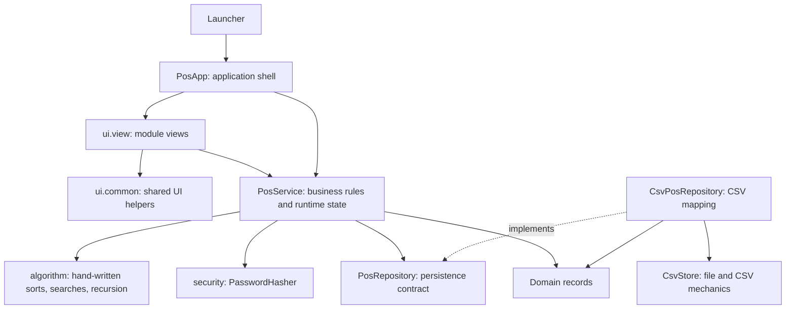

# Developer Architecture

Kofi is a small JavaFX desktop app. Its code is split by responsibility: the application shell wires screens together, each screen owns its own controls, the service owns business rules and in-memory state, and the repository owns CSV conversion and persistence.

## Dependency map



The dependency direction is intentional. `PosService` depends on the small `PosRepository` interface. `PosApp`, the composition root, chooses `CsvPosRepository` and passes it into the service. A different repository can be supplied without changing business rules.

## Source layout

| Location | Responsibility |
|---|---|
| `src/main/java/com/kofi/pos/Launcher.java` | Plain entry point (used by `run.cmd`, `javafx:run`, IDEs); starts `PosApp`. |
| `src/main/java/com/kofi/pos/app/PosApp.java` | JavaFX startup, sign-in, navigation, application shell, and screen wiring. |
| `src/main/java/com/kofi/pos/ui/view/` | One view per module plus the receipt dialog. |
| `src/main/java/com/kofi/pos/ui/common/` | Shared field/layout helpers (`UiSupport`) and the product table. |
| `src/main/java/com/kofi/pos/service/PosService.java` | In-memory collections (ArrayList, LinkedList, Stack, Queue), validation, product/sale/stock rules, reports, reset. |
| `src/main/java/com/kofi/pos/algorithm/` | Hand-written insertion/selection sort, linear/binary search, recursive sum. |
| `src/main/java/com/kofi/pos/security/PasswordHasher.java` | PBKDF2 password verification. |
| `src/main/java/com/kofi/pos/util/Money.java` | Single definition of money rounding. |
| `src/main/java/com/kofi/pos/model/` | Immutable product, sale, stock, settings, and activity records shared by layers. |
| `src/main/java/com/kofi/pos/data/PosRepository.java` | Narrow load/save/reset contract consumed by the service. |
| `src/main/java/com/kofi/pos/data/CsvPosRepository.java` | Coordinates loading/saving the six CSV files and the header (schema) check that auto-resets old-layout data. |
| `src/main/java/com/kofi/pos/data/csv/*Csv.java`, `CsvTable.java` | One class per file describing its columns and how a row maps to a record and back. |
| `src/main/java/com/kofi/pos/data/csv/CsvStore.java` | Seed initialization, restoring defaults, CSV quoting/parsing, and safe single-file replacement. |
| `src/main/resources/seed/` | The default dataset: copied to `data/` on first launch and restored by Settings > Reset data to default. |

## SOLID in this project

- **Single responsibility:** `PosApp` coordinates the app; each `*View` builds one module; `PosService` enforces store rules; `algorithm/` holds only algorithms; `PasswordHasher` only checks passwords; `CsvPosRepository` maps records; `CsvStore` handles files and CSV syntax.
- **Open/closed:** alternate storage can be added as another `PosRepository`. The service does not need to know whether its snapshot came from CSV or another source.
- **Liskov substitution:** any `PosRepository` implementation can replace `CsvPosRepository` while honoring the same load/save contract.
- **Interface segregation:** the repository port exposes only the operations the service needs: load and save a `StoreData` snapshot.
- **Dependency inversion:** business rules depend on `PosRepository`; CSV-specific classes sit behind that boundary. Wiring happens in `PosApp.start`.

The views receive the application service and small callbacks for navigation and notices. They do not read or write files. Domain records are immutable, so a stock change replaces a `Product` value instead of allowing UI code to mutate shared state.

## Main data flows

### Startup and sign-in

1. `PosApp.start` constructs `CsvStore`, `CsvPosRepository`, and `PosService`.
2. The service asks the repository for one `StoreData` snapshot.
3. The repository copies missing seeds, reads CSV rows, and converts each row to a model record.
4. The service initializes its collections, then rebuilds recent activity and the low-stock queue.
5. The login screen calls `PosService.authenticate`; password verification uses the stored salt and hash.

### Checkout

1. `PointOfSaleView` handles search, cart editing, tender input, and display validation.
2. The checkout action calls `PosService.checkout` with the cashier, discount, and tender.
3. The service validates the cart and money values, checks live stock again, then creates receipt lines using the current product name and price.
4. It reduces stock, records matching stock movements and dashboard activity, clears the cart, and refreshes low-stock alerts.
5. `saveAll` sends an immutable snapshot through `PosRepository`; the view then opens `ReceiptDialog`.

### Manual stock movement or sale void

Both actions validate at the service boundary, replace affected immutable `Product` records, append audit rows to the movement log, refresh the restock queue, and persist a snapshot. Voiding keeps the original sale and its lines, marks the sale voided, and restores sold units through new stock-in movements.

### Reset to default data

`SettingsView` asks for confirmation, then calls `PosService.resetToDefaults()`. The service asks `PosRepository.resetToDefaults()`, which makes `CsvStore.restoreDefaults()` overwrite every file in `data/` with its packaged copy from `src/main/resources/seed/`, and returns the restored snapshot. The service then replaces all in-memory collections (and empties the cart, activity stack and restock queue) via `applySnapshot`.

### CSV persistence

`CsvPosRepository` coordinates the files; each `*Csv` class knows its file name, column order, and record conversions. `CsvStore` knows how to quote CSV values and replace one file safely. Keeping those jobs separate means CSV format changes do not spread into the service or screen code.

## Adding a change

1. Put shared business rules in `PosService`, not in a button handler.
2. Put new screen controls in the relevant `ui/view/*View` class (shared helpers go in `ui/common`).
3. Add or update a model record when the value is part of the store domain.
4. If persisted fields change, update the matching `data/csv/*Csv` class and the seed header together; old `data/` files are then reset automatically on next launch.
5. Keep the repository interface narrow. Add a method only when the business service needs a new persistence operation.
6. Preserve the assignment-required collections and handwritten algorithms where they are exercised by the UI.

## Build and launch

Use JDK 17 or newer and Maven:

```powershell
mvn -DskipTests compile
mvn javafx:run
```

The Java sources target release 17. Maven is required for the normal developer workflow because it resolves JavaFX and launches the desktop app.
